# Our Journey Today {#our-journey-today .journey}



# Monte Carlo sampling helps us model and understand uncertainty

::: {.columns .application-gallery}
::: {.column width="33.33%"}
[Finance]{.alert}

[{fig-alt="Stock-market display"}](https://www.pexels.com/photo/numbers-on-monitor-534216/){.image-source target="_blank" rel="noopener" style="width: 95%;" title="View image source"}
:::
::: {.column width="33.33%"}
[Engineering]{.alert}

[{fig-alt="Hydraulic-fracturing water cycle and well diagram"}](https://d9-wret.s3.us-west-2.amazonaws.com/assets/palladium/production/s3fs-public/thumbnails/image/4Fraking42412-920.jpg){.image-source target="_blank" rel="noopener" style="width: 70%;" title="View image source"}
:::
::: {.column width="33.33%"}
[Image rendering]{.alert}

[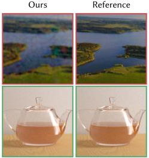{fig-alt="Ray-traced results compared with reference images"}](https://research.nvidia.com/publication/2023-05_recursive-control-variates-inverse-rendering){.image-source target="_blank" rel="noopener" style="width: 54%;" title="View image source"}
:::
:::

::: {.columns .application-gallery}
::: {.column width="33.33%"}
[Bayesian inference]{.alert}

[{fig-alt="Bayesian inference visualization"}](https://www.mdpi.com/2220-9964/13/3/97){.image-source target="_blank" rel="noopener" style="width: 94%;" title="View image source"}
:::
::: {.column width="33.33%"}
[Neural networks]{.alert}

[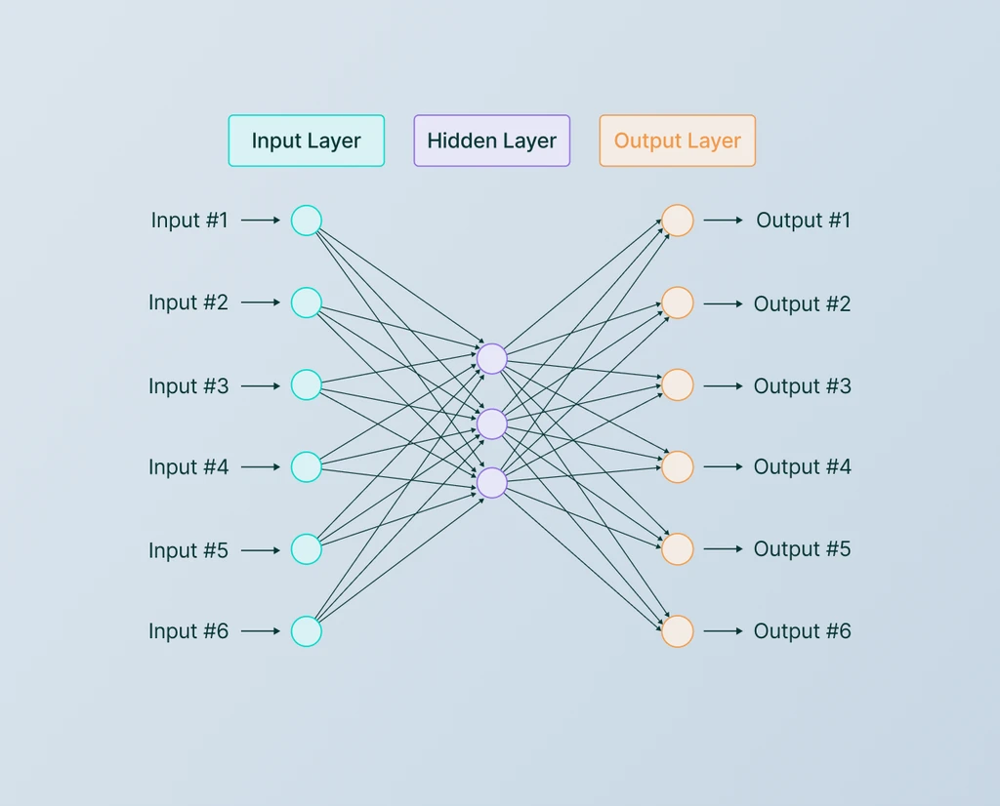{fig-alt="Neural-network diagram"}](https://www.v7labs.com/blog/neural-network-architectures-guide){.image-source target="_blank" rel="noopener" style="width: 71%;" title="View image source"}
:::
::: {.column width="33.33%"}
[Queues]{.alert}

[{fig-alt="In-N-Out drive-through queue"}](https://www.flickr.com/photos/disneymike/2090890736){.image-source target="_blank" rel="noopener" style="width: 89%;" title="View image source"}
:::
:::

## Why is there uncertainty?

| Application | Why samples help |
|:---|:---|
| Finance | Many possible market paths |
| Engineering | Variable material and system parameters |
| Image rendering | Represent all possible light paths |
| Bayesian inference | Unknown model parameters described by a high-dimensional posterior distribution |
| Neural networks | We explore selected directions in parameter space |
| Queues | Arrival and service times vary |

::: {.key-point}
In computer experiments, sampling gives us a collection of plausible scenarios that represent variability or uncertainty
:::

## How long should a trip take?

A 5-minute walk, a 30-minute train ride, and a 12-minute taxi ride are fixed

| Uncertain input | Model |
|:---|:---|
| Train wait | $W\sim\Unif(0,20)$ |
| Taxi unavailable | $B\sim\Bern(0.8)$; ready when $B=0$ |
| Taxi wait if unavailable | $E\sim\Exp(1/10)$; mean $10$ minutes |

Assume $W$, $B$, and $E$ are independent; all times are in minutes

\begin{equation*}
Y=5+W+30+BE+12=47+W+BE
\end{equation*}

::: {.key-point}
One sample means one plausible trip through these uncertain waits
:::

---

### One trip, many possible travel times

::: {style="text-align:center;"}
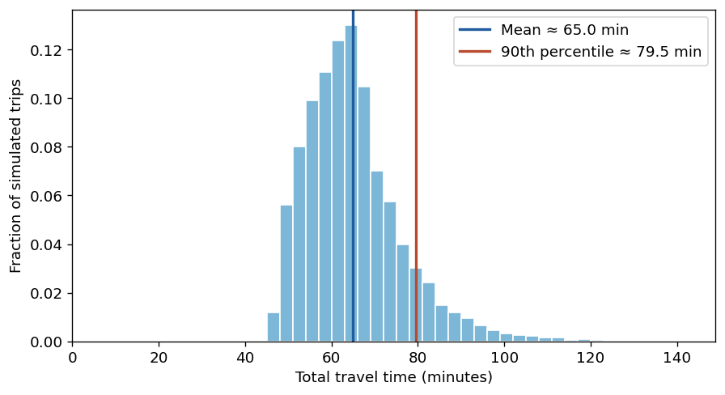{fig-alt="Histogram of simulated trip times, with vertical lines at the mean and 90th percentile" width=65%}
:::

20,000 simulated trips · the mean and a high percentile answer different questions

---

### Means, distributions, and quantiles

Let $\vX$ represent model inputs and $Y=f(\vX)$ the quantity of interest

\begin{equation*}
\vX_0,\vX_1,\ldots
\quad\longrightarrow\quad
Y_0=f(\vX_0),\;Y_1=f(\vX_1),\ldots
\end{equation*}

::: {.sampling-targets}

| Target | Sample approximation | Trip question |
|:---|:---|:---|
| Mean, $\mu$ | $\displaystyle \widehat\mu_n=\frac{1}{n}\sum_{i=0}^{n-1}Y_i$ | Average travel time |
| Distribution, $F$ | $\displaystyle \widehat F_n(t)=\frac{1}{n}\sum_{i=0}^{n-1}\indic(Y_i\le t)$ | Chance of arriving within $t$ minutes |
| Quantile, $Q$ | $\displaystyle \widehat Q_n(p)=\inf\{t:\widehat F_n(t)\ge p\}$ | Time to allow for a $90\%$ chance of arriving |

:::

For a quantile, $0<p<1$ specifies the desired probability

---

### A density is also a mean

:::: {.columns}
::: {.column width="36%"}

\begin{align*}
\varrho(t)&=\Ex\bigl[\varrho_{Y\mid Z}(t\mid Z)\bigr]\\
&\approx\frac{1}{n}\sum_{i=0}^{n-1}\varrho_{Y\mid Z}(t\mid Z_i)
\end{align*}

For taxi wait $Z=BE$

\begin{gather*}
\varrho_{Y\mid Z}(t\mid z)\\
=\frac{1}{20}\indic(47+z\le t<67+z)
\end{gather*}

:::
::: {.column width="4%"}
:::
::: {.column width="60%"}

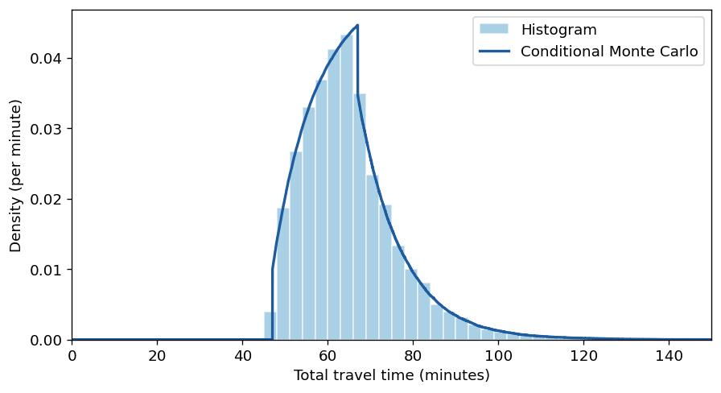{fig-alt="Histogram and conditional Monte Carlo density estimate from the same 20,000 simulated trips, showing a smoother conditional estimate with the model's jumps at 47 and 67 minutes retained" width=100%}

Same $20{,}000$ simulated trips

:::
::::

::: {.key-point}
We often use histograms for densities; conditional Monte Carlo can give a smoother estimate
:::

::: {.notes}
Given the taxi wait Z=z, Y is uniform on [47+z,67+z], so its
conditional density is (1/20) times the indicator of that interval.
The plot averages these exact conditional densities over the same 20,000
taxi waits used in the preceding trip histogram. The histogram here is
normalized as a density (per minute), rather than probability per bin.
No kernel or smoothing bandwidth is used. The density has actual jumps at
47 and 67 minutes because the taxi is immediately available with positive
probability; conditional MC retains these jumps. Density identities hold
almost everywhere, with endpoint conventions immaterial to probabilities.
See [L'Ecuyer, Puchhammer, and Ben Abdellah (2022)](https://doi.org/10.1287/ijoc.2021.1135)
for conditional Monte Carlo density estimation.
:::

## How do we want to sample?

Goal: estimate $\mu=\Ex[Y]$, $F(t)$, $Q(p)$, or $\varrho(t)$

Uniform inputs can be transformed to the model's required joint distribution

\begin{equation*}
\vU\in[0,1]^d\quad\xrightarrow{\text{probability transform}}\quad \vX
\quad\xrightarrow{\text{simulation}}\quad Y=f(\vX)
\end{equation*}

- [Target distribution]{.alert}: represent the model's probabilities and dependencies
- [Accuracy]{.alert}: reduce error for a fixed number of model evaluations
- [Flexibility]{.alert}: keep earlier evaluations when adding more samples
- [Error assessment]{.alert}: judge whether the numerical answer is accurate enough

::: {.key-point}
The model sets the target distribution\
We choose how the sample points work together
:::

---

### Different ways to place the samples

Each design has $64$ points in $[0,1]^6$ · only the first two coordinates are shown

::: {style="text-align:center;"}
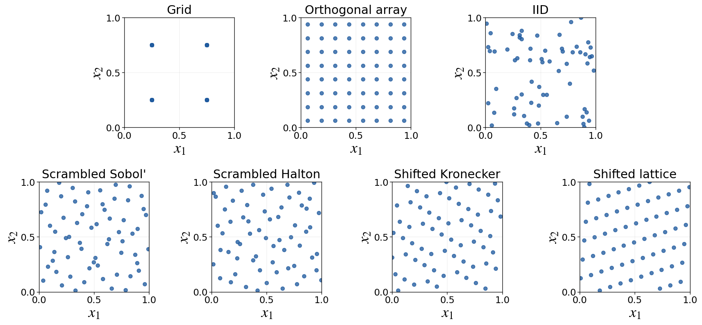{fig-alt="First-two-coordinate projections of 64 six-dimensional samples. Top row: grid, orthogonal array, IID. Bottom row: scrambled Sobol, scrambled Halton, shifted Kronecker, shifted lattice. The grid projects onto four positions." width=96%}
:::

::: {.notes}
The six-dimensional grid has two levels in every coordinate, hence 64 full
points but only four distinct positions in the displayed projection. The
strength-two orthogonal array has all 8-by-8 level combinations in every
coordinate pair. IID has random gaps and clusters. The bottom row shows
four low discrepancy methods: scrambled Sobol', scrambled Halton, shifted Kronecker, and a
randomly shifted lattice. A two-dimensional picture alone does
not establish integration accuracy for every function. These are the generator
points before periodization; the application comparisons use baker-transformed
lattice and Kronecker points.
:::

# Our Journey Today {#journey-before-low-discrepancy .journey .journey-after-monte-carlo}



# More Evenly Placed Samples {#more-evenly-placed-samples}

What do $n$-point, $d$-dimensional designs give us?

::: {.sampling-designs}

| Design | What we gain | What limits us |
|:---|:---|:---|
| Grid | Even spacing on a Cartesian grid | Only $n^{1/d}$ values per coordinate |
| Orthogonal array strength $s$ | Balanced $s$-coordinate projections | At most $n^{1/s}$ values per coordinate |
| IID | Any $n$ Unbiased mean Familiar error assessment | Random gaps and clusters $\operatorname{RMSE}=\std(Y)/\sqrt n$ |
| Low discrepancy (LD) | [Fine coordinate resolution]{.alert} [Joint placement reduces gaps]{.alert} [Randomization enables error assessment]{.alert} | Moderate smoothness helps Some designs [favor special $n$]{.alert} |

:::

::: {.notes}
The grid suffers the curse of dimensionality: a full Cartesian grid has
only n^(1/d) coordinate values. For an OA of strength s and positive integer
index lambda, the number of coordinate levels is (n/lambda)^(1/s), at most
n^(1/s), with equality at index one. Every cell of every s-coordinate
projection has the same count lambda; balance beyond s coordinates is not
guaranteed. The coordinate-value count refers to
the unjittered OA. In the earlier illustration, the OA has strength two
and index one, using eight levels in six dimensions. An eight-level full
grid there needs 8^6=262144 points, while the OA uses 64.
The plotted IID, scrambled Sobol', scrambled Halton,
shifted Kronecker, and shifted lattice designs each have 64 distinct values
in every coordinate; that fact alone does not establish integration accuracy.
With the correct input law and independent samples, the IID sample mean is
unbiased for an integrable output. For this unbiased mean estimator, RMSE
equals std(Y)/sqrt(n), provided Y has finite variance. Halving it needs four
times as many evaluations. Error
estimation using a sample variance and a confidence interval needs its usual
additional qualifications. No design is best for every integrand.
For the LD row, moderate mixed smoothness and low effective dimension can
make gains more pronounced; periodicity can particularly benefit lattice
rules. These are useful conditions, not universal requirements for every
LD method. Randomized points individually retain the uniform distribution;
independent replications allow estimation of the variability of their means.
The detailed rate depends on the construction and integrand.
:::

## Examples of how LD beats IID

### How long should a trip take? {#trip-mean-accuracy}

\begin{equation*}
\mu=\Ex[Y]=65\text{ minutes},\qquad
\operatorname{RMSE}_{\mathrm{IID}}=\sqrt{\frac{388}{3n}}
\end{equation*}

:::: {.columns}
::: {.column width="68%"}
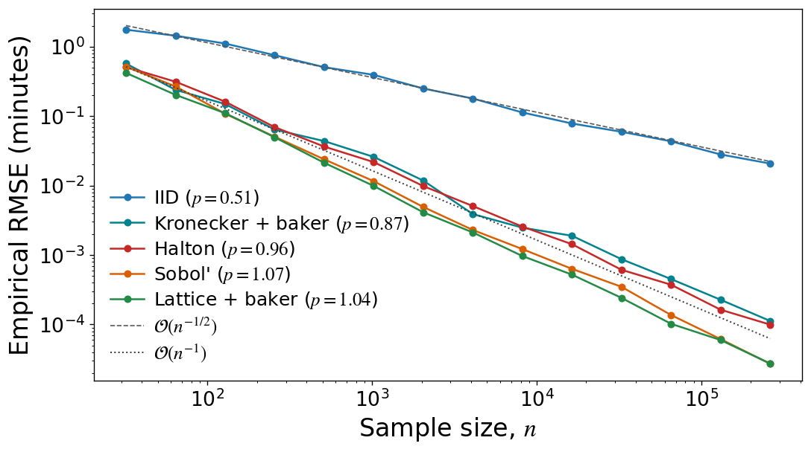{fig-alt="Trip-mean RMSE for IID, scrambled Sobol, scrambled Halton, baker-transformed shifted lattice, and baker-transformed shifted Kronecker, with measured convergence exponents and reference rates" width=100%}
:::
::: {.column width="4%"}
:::
::: {.column width="28%"}
$64$ randomizations

Compared at $n=2^m$

Fitted $p$ in the legend

$\operatorname{RMSE}\approx Cn^{-p}$

Baker map: $u\mapsto1-|2u-1|$
:::
::::

::: {.notes}
All methods use the same two-uniform inverse-CDF representation of the trip.
The train wait is 20 U_1. The taxi wait is zero up to U_2=0.2, then
-10 log((1-U_2)/0.8). This has the same distribution as B E in the first
section. The exact mean is 65 and variance is 388/3. The exponential tail
creates a logarithmic endpoint singularity in the cube integrand, so the
smooth scrambled-net n^(-3/2), up to logarithms, rate is not automatically
applicable. The measured exponents are fitted over 4096 through 262144,
using 64 independent replications and fixed seeds; they are not theorems.
Every calculation and plot is in the companion notebook.
The lattice and Kronecker use a random shift followed by the measure-preserving baker/tent
map, 1-2 abs(u-1/2), before the model's inverse CDF. This matches the default
BAKER periodization in QMCPy's CubQMCLatticeG, although these comparisons use
fixed budgets rather than adaptive stopping.
:::

---

### Keister: an oscillatory Gaussian integral

\begin{equation*}
\mu=\mpi^{d/2}\Ex\bigl[\cos(\norm{\vX})\bigr],\qquad
\vX\sim\Norm(\vzero,\mI_d/2),\qquad d=6
\end{equation*}

:::: {.columns}
::: {.column width="68%"}
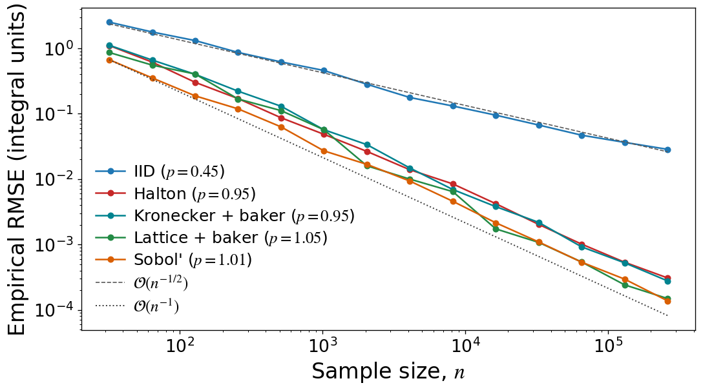{fig-alt="Six-dimensional Keister integral RMSE for IID, scrambled Sobol, scrambled Halton, baker-transformed shifted lattice, and baker-transformed shifted Kronecker, with measured convergence exponents and reference rates" width=100%}
:::
::: {.column width="4%"}
:::
::: {.column width="28%"}
Analytic reference

$64$ randomizations

Compared at $n=2^m$

Fitted orders $p$ in the legend
:::
::::

::: {.notes}
This is the standard Keister benchmark from B. D. Keister, Multidimensional
Quadrature Algorithms, Computers in Physics 10, 119–122 (1996), with the
usual Gaussian target covariance I/2. The analytic reference is approximately
-2.3273037293. We use the direct Gaussian inverse-CDF transformation without
an importance-sampling change. The fitted orders describe this experiment,
not universal rates for each design. Definitions and analytic evaluation:
[QMCPy integrands](https://qmcsoftware.org/qmcpy/api/integrands/).
:::

---

### Asian option: pricing simulated market paths

\begin{equation*}
\mu=e^{-rT}\Ex\left[\left(\frac1{52}\sum_{j=1}^{52}S(t_j)-K\right)_+\right]
\end{equation*}

:::: {.columns}
::: {.column width="68%"}
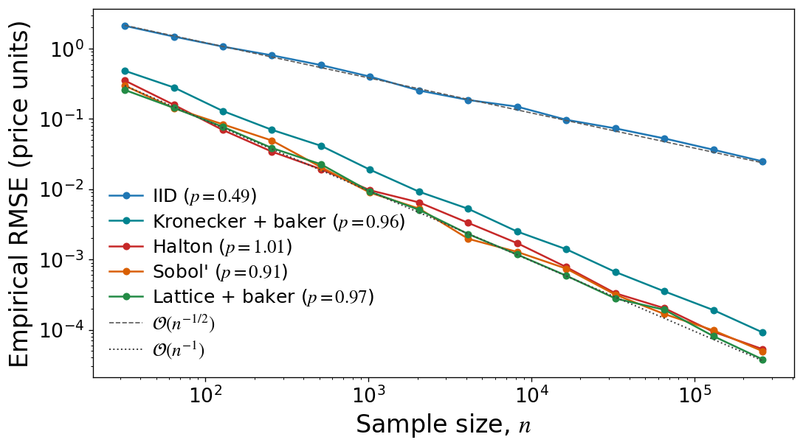{fig-alt="One-year arithmetic Asian call with 52 weekly observations: RMSE for IID, scrambled Sobol, scrambled Halton, baker-transformed shifted lattice, and baker-transformed shifted Kronecker, with measured convergence exponents and reference rates" width=100%}
:::
::: {.column width="4%"}
:::
::: {.column width="28%"}
$52$ weekly dates over one year

$S_0=K=100$

$r=0.05,\quad \sigma=0.3$

$T=1$

$64$ randomizations

Compared at $n=2^m$
:::
::::

::: {.notes}
The stock follows geometric Brownian motion under the risk-neutral measure.
All methods use the same PCA construction of its 52 Brownian values,
right-endpoint weekly observations over one year, arithmetic averaging, and discounted
call payoff. Parameters are illustrative. The comparison uses plain payoff
averages, without the geometric control variate used for the separate reference.
The reference price is approximately 8.06778291608, estimated by 32 independent
scrambles of 2^22 paths with a geometric-Asian control of known expectation.
Its replication standard error is 9.97e-7; three reference standard errors
are 7.90 percent of the smallest plotted RMSE. The Asian Kronecker design uses
the first 52 coordinates of the existing 100-dimensional MCQMC vector;
the trip and Keister designs retain QMCPy's built-in CBC vector.
The pilot control coefficient,
independent reference seeds, all comparison estimates, fitted orders, and
plots are recorded in the notebook and sampling_convergence.json.
:::

---

### A beam with uncertain stiffness

A beam clamped at both ends, with position $x\in[0,1]$ along its length

\begin{gather*}
(B(x,\vZ)w''(x,\vZ))''=1,
\qquad Y(\vZ)=384w(1/2,\vZ),
\qquad \mu=\Ex[Y]\\
w(0,\vZ)=w'(0,\vZ)=w(1,\vZ)=w'(1,\vZ)=0
\end{gather*}

- [Stiffness profile]{.alert}: eight cosine modes for the log stiffness, with independent Gaussian coefficients
- [Sampling dimension]{.alert}: $d=8$ coefficients determine one stiffness profile
- [Spatial integration]{.alert}: composite four-point Gauss–Legendre quadrature on eight equal cells

The normalized midpoint deflection is $Y=1$ for uniform unit stiffness

[Synthetic model and reproducible solver in the companion notebook](https://github.com/fjhickernell/StrategicSamplingColloquium/blob/main/notebooks/StrategicSampling.ipynb){.small}

::: {.notes}
The implemented field is
B(x,Z)=exp(sum_{j=1}^8 b_j(x) Z_j - (1/2) sum_{j=1}^8 b_j(x)^2),
where b_j(x)=0.45 sqrt(2) j^(-3/2) cos(pi j x)/sqrt(sum_{k=1}^8 k^(-3)).
The sampling dimension d counts the eight random coefficients; x is the
one-dimensional physical coordinate on [0,1]. The 32 spatial quadrature
nodes lie inside a single deterministic beam solve and are not random inputs.
This is the finite random-field representation implemented in log_basis and
stiffness, with independent standard normal coefficients. The Gaussian
lognormal correction makes the stiffness mean one at every x. The coefficient
0.45 is the RMS spatial standard deviation of log stiffness over [0,1].
The field is evaluated continuously from the cosine expansion. The plotted
beam solves use 32 quadrature locations, four per spatial cell; the eight
stochastic coefficients and eight quadrature cells are separate choices.
Equilibrium and compatibility reduce the clamped-beam solve to weighted
integrals of compliance and a two-by-two linear system. These quadrature
integrals, rather than piecewise-constant material values, are discretized.
:::

---

### The beam and its spatial quadrature

::: {style="text-align:center;"}
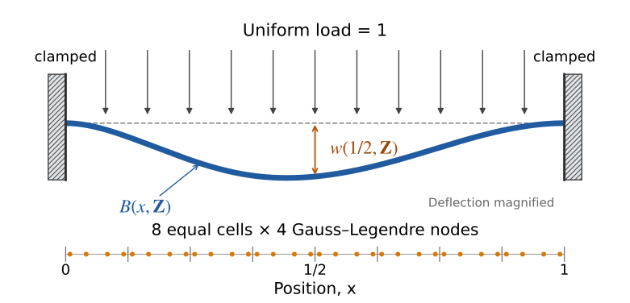{fig-alt="A beam clamped at both ends under uniform loading, with one exaggerated deflected shape, midpoint deflection, position from zero to one, and 32 Gauss–Legendre nodes grouped into eight equal spatial cells" width=94%}
:::

::: {.notes}
The blue shape is one solution for the existing eight-mode stiffness model,
with vertical deflection magnified for visibility. The dashed line is the
undeformed beam. Clamps impose zero displacement and zero slope at both ends.
The lower strip shows the actual four-point Gauss–Legendre nodes on each
of eight equal cells, as returned by the solver's rule(8). These 32 spatial
nodes are internal to each solve; sampling dimension remains d=8.
The notebook generates both the vector drawing and its PNG preview.
:::

---

### Beam: same budget, different sampling variability

:::: {.columns}
::: {.column width="68%"}
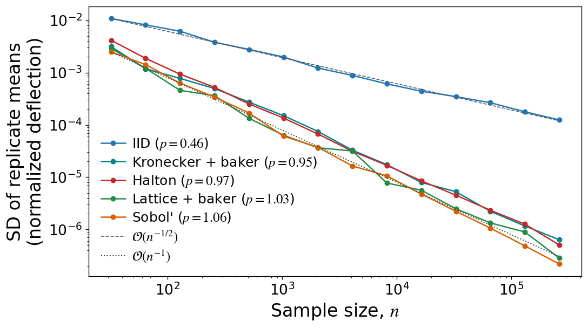{fig-alt="Standard deviation across independent replicate beam estimates for IID, scrambled Sobol, scrambled Halton, Lattice plus baker, and Kronecker plus baker at equal sample sizes" width=100%}
:::
::: {.column width="4%"}
:::
::: {.column width="28%"}
$d=8$ Gaussian inputs

$64$ randomizations

Compared at $n=2^m$

Same beam solves per replication

Spatial-resolution error requires a separate check
:::
::::

::: {.notes}
This compares the sample standard deviation of independent replicate means
for the fixed eight-cell beam solver, not RMSE against a certified continuum
reference. Lattice and Kronecker use the baker transform before the Gaussian
inverse CDF. All methods use the same model, solver, sample sizes, and number
of replications. The notebook records all estimates and fitted SD exponents.
:::

## Why randomize a structured design?

A random shift or scramble retains the design's coverage pattern

- Every point is [uniformly distributed]{.alert} on the unit cube
- Independent [replications]{.alert} give a way to assess sampling variability
- No points on the boundary of the unit cube that get mapped to [infinity]{.alert}

::: {.key-point}
Randomized low discrepancy joins organized placement with uncertainty assessment
:::

::: {.notes}
With continuous uniform randomization, a finite point set avoids the unit-cube
boundary almost surely. Finite-precision implementations still need endpoint
guards before inverse transforms; the notebook explicitly handles them.
:::

## Kernel-based discrepancy

\begin{equation*}
\mu=\Ex[f(\vX)]=\Ex[g(\vU)]
=\int_{[0,1]^d}g(\vu)\,\dif\vu
\end{equation*}

The reproducing kernel $K$ defines a Hilbert space $\cf$ of integrands

\begin{equation*}
\Dsc^2(P_n;K)=\sup_{\norm{g}_{\cf}\le1}
\left|\int_{[0,1]^d}g(\vu)\,\dif\vu
-\frac1n\sum_{i=0}^{n-1}g(\vu_i)\right|^2
\end{equation*}

\begin{equation*}
|\mu(g)-\widehat\mu_n(g)|\le\norm{g}_{\cf}\,\Dsc(P_n;K)
\end{equation*}

- The kernel encodes [smoothness and coordinate importance]{.alert}
- With [moderate mixed smoothness]{.alert}, suitable designs attain $\Dsc(P_n;K)=\Order(n^{-1+\epsilon})$ for every $\epsilon>0$

::: {.key-point}
The bound is usually impractical for estimating the error\
Discrepancy gives a [figure of merit]{.alert} for sampling designs
:::

::: {.notes}
Here P_n consists of unit-cube nodes and the Hilbert space is an RKHS with
integrable kernel and bounded integration functional. The bound applies
when g belongs to that space; the application examples are not being
asserted to satisfy every smoothness assumption used in an arbitrary kernel.
The integrand norm is generally unavailable or difficult to bound, so this
worst-case inequality is not presented as an operational error estimate.
For a chosen kernel, discrepancy instead provides a criterion for comparing
and constructing designs for the associated function class.
The near-n^(-1) statement refers to appropriate mixed-smoothness spaces and
suitably chosen designs, not arbitrary kernels or point sets. For example,
first-order Sobolev-type spaces admit near-n^(-1) worst-case convergence.
Constants can depend on the kernel, dimension and epsilon; dimension-robust
constants require additional weight conditions. See HKS26 and the research
decks' matching discrepancy bound.
Source: the MCQMC 2026 special-session discrepancy slides and HKS26.
:::

---

### Computing discrepancy from the kernel

\begin{align*}
K_0&:=\int_{[0,1]^d}\int_{[0,1]^d}K(\vu,\vv)\,\dif\vu\,\dif\vv\\
K_1(\vu)&:=\int_{[0,1]^d}K(\vu,\vv)\,\dif\vv
\end{align*}

\begin{equation*}
\Dsc^2(P_n;K)=K_0
-\frac2n\sum_{i=0}^{n-1}K_1(\vu_i)
+\frac1{n^2}\sum_{i,j=0}^{n-1}K(\vu_i,\vu_j)
\end{equation*}

- Only the [sample points and kernel]{.alert} are needed
- No expensive model evaluations
- Discrepancy typically requires $\mathcal{O}(n^2)$ operations to compute

::: {.notes}
The direct pairwise formula uses n^2 kernel evaluations. The operation count
treats the dimension and the cost of one kernel evaluation as fixed; special
kernel/design structure can permit faster computation.
:::

---

### Discrepancy under a random shift

Use one common $\vDelta\sim\Unif([0,1]^d)$ and $\vu_i^{\vDelta}=(\vu_i+\vDelta)\bmod1$

\begin{gather*}
\tK(\vt):=\int_{[0,1]^d}K\bigl((\vt+\vv)\bmod1,\vv\bigr)\,\dif\vv,
\qquad \overline K:=\int_{[0,1]^d}\tK(\vt)\,\dif\vt\\[0.5em]
\ESD(P_n;K):=\Ex_{\vDelta}\bigl[\Dsc^2(P_n^{\vDelta};K)\bigr]=-\overline K+\frac1{n^2}\sum_{i,j=0}^{n-1}\tK\bigl((\vu_i-\vu_j)\bmod1\bigr)
\end{gather*}

::: {.key-point}
The formula applies to [every prefix length $n$]{.alert}
:::

::: {.notes}
All shifts and differences are componentwise modulo one. The shift-averaged
kernel depends only on the difference of the two nodes, and its integral
bar K equals K_0 from the preceding slide. Expected squared discrepancy is
an average of squared worst-case errors; it is not identical to the variance
for one fixed integrand. For g in the RKHS, its shift-averaged squared error
is bounded by norm(g)^2 times ESD. This is the general random-shift identity
from the MCQMC 2026 special-session talk. The notebook checks the kernel-sum
identity and the random-shift formula numerically.
:::

## The catch: favored sample sizes

| Design | Natural prefixes |
|:---|:---|
| IID | Every $n$ |
| Scrambled Sobol' and standard lattice rules | Strongest balance at $n=2^m$ |
| Halton and Kronecker sequences | Every $n$ |

Why [not]{.alert} a favored sample size?

- Budget constraints
- Missing data $f(\vX_i)$

## Lattice prefixes between favored sizes

::: {style="text-align:center;"}
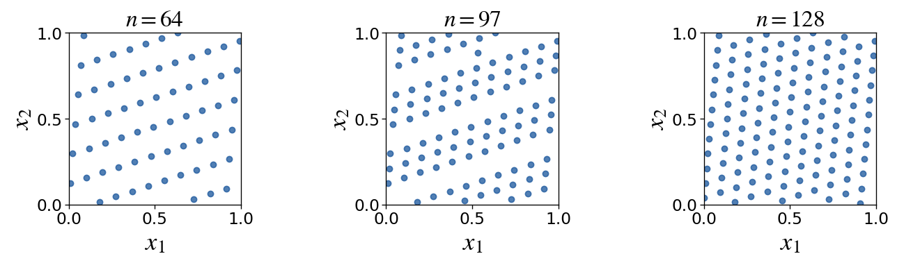{fig-alt="The first 64, 97, and 128 points of one randomly shifted extensible lattice sequence, showing how its coverage changes between powers of two" width=82%}
:::

::: {.notes}
All three panels use prefixes of the same shifted base-two lattice sequence,
before the baker transform. The middle panel is the first 97 points of the
128-point ordering, not a separately constructed rank-one rule of modulus 97.
Budget constraints can stop sampling between favored sizes, and failed model
evaluations can leave some f(X_i) unavailable. The figure illustrates a prefix,
not a particular missing-data pattern or an integration-error guarantee.
:::

## QMCPy: a community toolbox

[QMCPy](https://qmcpy.org/) connects

- Sampling designs
- Probability transforms
- Integrands
- Error assessment



::: {.notes}
Photo selection confirmed by Fred on November 13, 2026. The selection includes
Sou-Cheng Choi, Yuhan Ding, Joshua Herman, R. Jagadeeswaran, Aadit Jain,
Larysa Matiukha, Art Owen, Pieterjan Robbe, Aleksei Sorokin, Laasya Priya
Vemuri, and Yifei Xiong. Laasya is listed once. Art contributes ideas even
where he has contributed little code. These portraits recognize selected
contributors to QMCPy's ideas and software, not an exhaustive list of the
broader community.
:::

## QMCPy: activity on PyPI

::: {style="text-align:center;"}
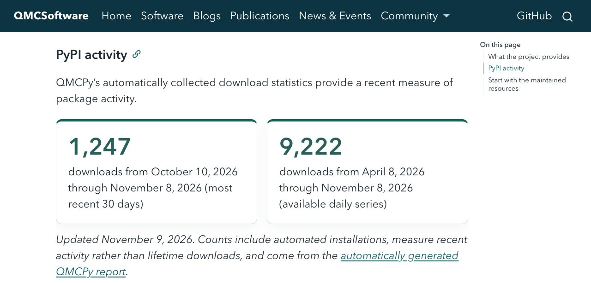{fig-alt="Screenshot of the QMCPy website showing 1,247 PyPI downloads from October 10 through November 8, 2026, and 9,222 downloads in the available daily series from April 8 through November 8. The report was updated November 9 and includes automated installations." width=96%}
:::

[qmcsoftware.org/software/qmcpy.html](https://qmcsoftware.org/software/qmcpy.html#pypi-activity){.small} · captured November 14, 2026

::: {.notes}
An actual website screenshot, captured November 14, 2026. The visible data
were updated November 9 and run through November 8. These are package
downloads, including automated installations, not counts of individual users
or lifetime downloads. The website links to the automatically generated
QMCPy report.
:::

# Our Journey Today {#journey-before-recent-work .journey .journey-after-low-discrepancy}



# Recent Work: Flexible Sample Sizes {#recent-work-flexible-low-discrepancy}

An [extensible sequence]{.alert} keeps every prefix

The research question is the [quality of every prefix]{.alert}, not just the full preferred blocks

Suppose preferred sample sizes satisfy $\Dsc(P_{n_m};K)\le Cn_m^{-p}$, $m=0,1,\ldots$

- Losing or adding a [bounded number]{.alert} of arbitrary points
  - Keep the [same rate]{.alert} when $p\le1$
  - Still get $\Order(n^{-1})$ when $p>1$
- Losing or adding a [fraction $\alpha$]{.alert} of the points: we can only guarantee discrepancy of $\Order(\alpha)$
- Under standard discrepancy lower bounds, $p>1$ requires [unbounded gaps]{.alert} between preferred sample sizes

::: {.notes}
P_n is the equal-weight design {u_i}_{i=0}^{n-1}, with vector-valued nodes.
The modified design tilde P_n results from arbitrary additions or deletions,
so it need not remain a prefix of the original sequence. Assume a uniform
upper bound A on discrepancy for arbitrary finite point sets, as supplied
by a bounded kernel diagonal. If at most r points are changed, the triangle
inequality gives, for deletions,
D(tilde P_{N-r}) <= (C N^(1-p) + A r)/(N-r); additions have denominator N+r.
For bounded r, this gives O(N^(-min(p,1))): the rate is preserved for p<=1,
and at least O(N^-1) remains when p>1. The fraction bound holds uniformly
for r<=alpha N with alpha bounded away from 1. It is an upper guarantee,
not a lower error floor or a claim that every missing-data pattern attains it.
The gap statement additionally assumes the usual positive point-set lower
bound a q^(-Q) <= D(Q_q), with a>0. The block triangle inequality then forces
preferred-size gaps to be unbounded when p>1 (and to tend to infinity under
these uniform bounds). Thus faster-than-1/n discrepancy cannot hold for every
prefix in these nondegenerate spaces. These are the mathematical results
checked against the other talk's 'The best we can hope for' and proofs slides.
:::

## Lattice and Kronecker: two ways to proceed

The base-two [van der Corput sequence]{.alert} $\phi_2(i)$ reverses the binary digits of $i$ after the binary point

\begin{equation*}
\phi_2(6)=\phi_2\bigl((110)_2\bigr)=(0.011)_2=3/8
\end{equation*}

::: {.columns}
::: {.column width="47%"}
### Lattice sequence

\begin{gather*}
\vu_i=\phi_2(i)\,\vzeta+\vDelta\pmod 1\\
\vzeta\in\naturals^d
\end{gather*}

Strong structure at powers of two
:::
::: {.column width="6%"}
:::
::: {.column width="47%"}
### Kronecker sequence

\begin{gather*}
\vu_i=i\,\vzeta+\vDelta\pmod 1\\
\vzeta\in[0,1)^d
\end{gather*}

Take another step by the same vector $\vzeta$

A natural prefix at every $n$
:::
:::

For the finite search range $n\le N$, use one random shift $\vDelta\sim\Unif([0,1)^d)$ per realization

::: {.notes}
The van der Corput map reverses the finite binary expansion of a nonnegative
integer and places it after the binary point: phi_2((a_m...a_0)_2) equals
(0.a_0...a_m)_2. Thus 6=(110)_2 maps to (0.011)_2=3/8.
The lattice generator is an integer d-vector; the Kronecker generator can be
reduced modulo one to [0,1)^d. All node, generator and shift symbols are vectors.
The displayed ordinary integer lattice vector represents a finite search
horizon N. A truly infinite extensible lattice uses generalized base-two
integer digits, as in Matiukha, Ding and Hickernell's background section.
The shift is common to every point within one realization and independent
across replications. These parameter domains alone do not guarantee a good
sequence; the later construction slides address generator selection.
The definitions and example were checked against the other talk's lattice
and Kronecker comparison; no visible cross-talk citation is needed here.
:::

## How do we choose a good sequence?

\begin{equation*}
\operatorname{WSESD}(N,d)=\sum_{n=1}^{N}n^{1-\epsilon}\,\ESD(P_n;K),\qquad \epsilon>0
\end{equation*}

[WSESD]{.alert}: weighted sum of expected squared discrepancy over all prefixes

[ESD: expected squared discrepancy]{.alert}, $\ESD(P_n;K)=\Ex_{\vDelta}[\Dsc^2(P_n^{\vDelta};K)]$

\begin{align*}
\ESD_{\mathrm{lattice}}(n)
&=-\overline K+\frac1{n^2}\biggl[n\tK(\vzero)+\sum_{k=1}^{2^m-1}c_n(k)\,\tK(\phi_2(k)\vzeta\bmod1)\biggr]\\[0.5em]
\ESD_{\mathrm{Kronecker}}(n)
&=-\overline K+\frac1{n^2}\biggl[n\tK(\vzero)+2\sum_{k=1}^{n-1}(n-k)\,\tK(k\vzeta\bmod1)\biggr]
\end{align*}

$m=\lceil\log_2 n\rceil$; $c_n(k)$ counts ordered scalar differences equal to $\phi_2(k)$ modulo one

- [Linear ESD cost]{.alert}: $\Order(n)$ operations for fixed $d$, using fewer than $2n$ kernel terms
- [Linear WSESD cost]{.alert}: $\Order(N)$ per candidate generator after precomputing sample-size weights

::: {.notes}
The shifted kernel tilde K and its integral bar K were defined on the earlier
random-shift slide. Both formulas group the n^2 ordered pairs by distinct
scalar differences. For the lattice, c_n(k) counts ordered scalar pairs
(i,j) with phi_2(i)-phi_2(j)=phi_2(k) modulo one, i,j<n. If 2^(r-1)<=k<2^r,
then c_n(k)=n-(n mod 2^r)+2 max((n mod 2^r)-2^(r-1),0).
These multiplicities are constant on dyadic blocks and can be filled in
O(2^m)=O(n) work. The Kronecker coefficient 2(n-k) combines the positive
and negative lags using the evenness of the shift-averaged kernel.
Linear operation counts assume the shifted kernel is available in a usable
closed form and hold d fixed. For product kernels a fresh kernel evaluation
costs O(d), giving O(d n); cached CBC coordinate products give O(n) per
candidate coordinate. The WSESD statement is per candidate after weights that
depend only on sample size have been prepared; it does not claim that N
separate O(n) computations, coefficient setup, or a whole CBC search are O(N).
The current objective uses w_n=n^(1-epsilon). In the lattice aggregate, the
dyadic-block weights are q_r=sum_{n=1}^N n^(-1-epsilon) c_n(k) for k in block r.
The Kronecker kernel coefficient for lag k is
2 sum_{n=k+1}^N (n-k) n^(-1-epsilon), computable from cumulative power sums.
The constant and zero-lag coefficients are respectively
-bar K sum_{n=1}^N n^(1-epsilon) and tilde K(0) sum_{n=1}^N n^(-epsilon).
Thus the per-candidate linear cost remains valid after the sample-size weights
are prepared. This weighting supersedes the n-weighted objective in the
reference talk; its individual ESD identities remain unchanged.
The small positive epsilon in this aggregate weight need not be the same
parameter as the epsilon in the near-n^(-1+epsilon) discrepancy bound.
Fred does not want to specify their exact correspondence in this talk.
The notebook checks both grouped formulas against
all-pairs sums, including a non-power-of-two lattice prefix.
:::

## Component-by-component construction

For each coordinate $\ell=1,\ldots,d$, choose

\begin{equation*}
\zeta_\ell\in\operatorname*{arg\,min}_{z\in\mathcal C_\ell}
\operatorname{WSESD}(N,\ell;\zeta_1,\ldots,\zeta_{\ell-1},z)
\end{equation*}

- Keep the [previous coordinates fixed]{.alert}: $\zeta_1,\ldots,\zeta_{\ell-1}$
- Choose the [next coordinate]{.alert} $\zeta_\ell$ to minimize WSESD over its allowed candidates $\mathcal C_\ell$
- Fix that choice and proceed to coordinate $\ell+1$

::: {.notes}
The semicolon makes the dependence of the criterion on the candidate generator
explicit. At stage ell, use the ell-dimensional criterion and hold every
previously chosen coordinate fixed. The candidate set reflects the lattice
or Kronecker construction. This is conditional minimization at each stage,
not a claim of a global minimum over all d-dimensional generating vectors.
:::

## Recent contributions

Building on past collaboration with
Peter Kritzer
Frances Kuo
Dirk Nuyens
<a class="past-collaboration-cite" href="" target="_blank" rel="noopener">Hickernell et al. (2012)</a>

<ul class="research-contributions" role="list">
<li>

Larysa Matiukha — showed that lattice generating vectors $\vzeta$ exist with good discrepancy for every sample size $n$ and dimension $d$
<a href="https://arxiv.org/abs/2610.10543" target="_blank" rel="noopener">Matiukha, Ding &amp; Hickernell (2026), arXiv:2610.10543</a>

</li>
<li>

Anders Pride — derived the lattice WSESD formulas and extended them beyond van der Corput ordering, including Gray code

</li>
<li>

Jiangrui Kang — proved that the CBC construction produces such generating vectors

</li>

<li>

Megan Millet — is exploring fast computation of nonconstant sample weights to reduce discrepancy for arbitrary $n$
$\displaystyle \mu \approx \frac1n\sum_{i=0}^{n-1} w_{n,i}g(\vu_i)$

</li>
</ul>

## Low discrepancy for arbitrary $n$ {#current-prefix-comparison}

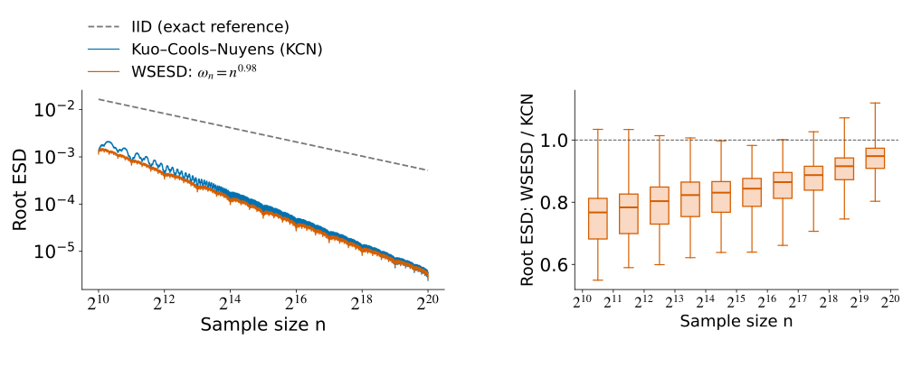{fig-alt="Independent reconstruction of Jiangrui Kang's current 13-dimensional lattice benchmark. Left: root expected squared discrepancy for KCN and a WSESD lattice at every integer sample size, with the analytic IID reference. Right: WSESD-to-KCN discrepancy ratios within each open doubling interval; dots show medians, shading the tenth to ninetieth percentiles, and crosses the worst prefix." width=96%}

$d=13$ · $2^{10}\le n\le N=2^{20}$ · $w_n=n^{0.98}$

Non-dyadic $n$: [94.7% improve]{.alert} on KCN · [11.9% worst increase]{.alert}

::: {.notes}
Current manuscript computations, independently reconstructed from the supplied
generating vectors at manuscript commit 30c1f37, November 14, 2026. This
replaces the historical 64-dimensional lattice/Kronecker plot; the new
comparison contains lattices and an analytic IID reference, no Kronecker rule.
KCN is the published Cools–Kuo–Nuyens embedded lattice vector. Both lattice
vectors are fixed for maximum N=2^20 and dimension 13, with binary
radical-inverse point order. The kernel is product_j(1+j^(-2) B_2({x_j-y_j})),
where B_2(t)=t^2-t+1/6. Root ESD is invariant under a common random shift.

The displayed WSESD vector is called W_0.01 in the manuscript, whose parameter
convention uses n^(1-2 epsilon). The explicit weight n^0.98 avoids confusing
that parameter with the talk's generic n^(1-epsilon) convention. Do not state
an exact correspondence with the epsilon in the discrepancy-rate bound.

The left panel retains every integer n from 1024 through 2^20; the right
summarizes all non-dyadic n separately within each open doubling interval.
Quantiles describe variation across n, not confidence intervals. Ratios below
one favor WSESD. On the pooled 1,047,542 non-dyadic sizes, 992,176 improve
on KCN (94.7147%), median ratio 0.919964, worst ratio 1.119134 at n=1048568.
Pooling weights individual integers equally, so the last interval contributes
nearly half. Dyadic endpoints are not included in that percentage: 7 of 11
improve, with worst ratio 1.120865 at n=2^20. These are finite-prefix
comparisons, not a uniform superiority result or an application error estimate.

The independent reconstruction checks 48 small direct pair sums and 132
published endpoints; maximum endpoint relative difference is 5.11e-7.
All eight manuscript discrepancy win counts agree exactly. It evaluates the
supplied vectors, without certifying CBC greedy minima or rerunning the
integration experiments, whose raw arrays are stored outside the repository.
Source, command, and verification record: examples/wsesd/check_discrepancy.py
and assets/figures/wsesd_prefix_discrepancy.json.
:::

## Back to the beam: 64 lost evaluations

64 random losses from $2^{18}$ evaluations · first $n$ survivors

::: {style="text-align:center;"}
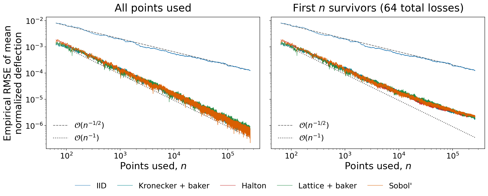{fig-alt="Paired beam mean-error plots: the first n evaluations of the complete sequence on the left, and the first n surviving evaluations on the right. Each replication removes one uniform random set of 64 indices from the full 262144-point sample, shared across all five methods and growing prefixes. Both panels begin at n equals 64 and have trend guides with slopes minus one half and minus one. The horizontal axes count evaluations actually used." width=96%}
:::

$64$ randomizations · every integer $n$ (evaluations used)

::: {.key-point .small}
Losses accumulate as $n$ grows, so the slope over this range need not be the asymptotic rate
:::

::: {.notes}
Both panels measure empirical RMSE against an independent reference for the
mean normalized deflection of the same fixed eight-cell numerical beam model.
The reference uses 32 independent Sobol scrambles with 2^22 points each;
its mean is approximately 1.11614674373 and its replication standard error
is 2.43e-9. Three reference standard errors are 3.35% of the smallest plotted
RMSE. This is a statistical reference, not a certified continuum error bound;
spatial-discretization error is separate.
In each of 64 comparison replications, draw one set of 64 indices uniformly
without replacement from the full 2^18-point sample, independently of output
values. Use this same loss set across all five methods and every growing
prefix in that replication. Draw a new independent set in each replication.
The right panel averages the first n surviving values in their original order;
the left panel averages the first n complete-sequence values. Both start at
n=64. The number of losses encountered in an early prefix can be zero, one,
or more; it is not forced to be 64. The attempted prefix needed for n
survivors varies by replication and is recorded in the JSON.
Both curves show every integer n from 64 onward. The complete curve ends
at 2^18, and the survivor curve at the final available count 2^18-64=262080.
Complete and incomplete estimates use the same underlying randomized
sequence. The complete estimates reproduce the earlier beam experiment. Generators,
baker transforms, and solver resolution match the earlier application plots.
Both panels include n^(-1/2) and n^(-1) slope guides with the same
normalizations, anchored to the first complete IID and Sobol RMSE values,
respectively. These are visual trend guides, not fitted laws or guarantees.
The full all-n RMSE arrays are saved in beam_missing_points_rmse_all_n.npz.
Per-replication checkpoint estimates, missing indices, and reference
diagnostics are in beam_missing_points_rmse.json; the notebook regenerates
the full numerical experiment.
For IID, value-independent removal leaves an IID sequence, so the two
empirical RMSE curves should be close at the same n. Finite-replication
differences remain; identical empirical curves are not required.
Fixed losses do not guarantee preservation of a rate faster than 1/n.
At the full-pool endpoint, conditional on the N output values, uniformly
removing r values adds variance r*s_N^2/[N*(N-r)] to the full mean's MSE,
where s_N^2 is the finite-sample variance with denominator N-1. The extra
RMSE is therefore of order sqrt(r)/N if the expected sample variance is
bounded. This caps a faster preferred-size rate at 1/N, while preserving
the IID rate at the retained count. The beam outputs need not be bounded;
this explanation uses finite second moments instead of a uniform output bound.
Within this finite-pool prefix experiment, the number of encountered losses
grows with n rather than remaining 64 in every prefix. In an attempted
prefix of length m its expected value is 64*m/2^18. Thus an apparent slope
over this range is not by itself an asymptotic-rate conclusion. Showing all
integer n also separates preferred-size troughs from typical prefix behavior.
:::

# Our Journey Today {#journey-before-practice .journey .journey-after-recent-work}



# Future: Human Intelligence + AI Accelerating Discovery {#ai-accelerated-research}

We already use AI to

- Review the literature
- Construct arguments
- Edit writing

::: {.key-point}
[Human intelligence is needed to guide AI]{.alert} and check its reasoning
:::

::: {.small}
In our proposals, we use the term [“Super Intelligence” (SI)](https://www.whitehouse.gov/presidential-actions/2026/09/inaugurating-the-era-of-super-intelligence/)
:::

::: {.notes}
Keep this future section brief in the 50-minute talk, about three minutes
across its two content slides. AI is the term used in the talk. The SI line
reflects Fred's proposal context. The linked September 29, 2026 executive
order directs executive-branch use of “Super Intelligence” and “SI”. This
terminology does not claim that today's QMCPy agent is superintelligent.
Human guidance includes choosing worthwhile questions, checking arguments,
verifying literature citations, and interpreting numerical evidence.
:::

## An AI companion for QMCPy

We are developing an [AI agent to accompany QMCPy]{.alert} and assist practitioners

- Translate a practitioner's question into a sampling experiment
- Help choose designs, probability transforms, and error assessment
- Run QMCPy tools and explain the numerical evidence

[Pydantic AI]{.alert} can connect the agent to those tools

::: {.key-point}
How far can human intelligence + AI accelerate discovery?
:::

::: {.notes}
This is work in development and a direction for future research. The listed
capabilities describe the intended practitioner experience, not a released
general-purpose QMCPy assistant. Mention Pydantic AI briefly as possible
support for typed tools; omit implementation detail and the scripted demo.
The existing bounded beam prototype remains in examples/beam/ for exploration.
:::

## Take-home message

::: {.main-message}
Sample more strategically while keeping the freedom to add more as needed, and do not sweat the data losses
:::

- LD often beats IID by [a lot]{.alert}
- Mathematics constructs and assesses LD sequences across sample sizes
- QMCPy makes the designs usable in simulations
- Human intelligence guides AI toward useful, checked discoveries

## Sources and further exploration

- [Companion notebook and beam code](https://github.com/fjhickernell/StrategicSamplingColloquium)
- [Hickernell, Kritzer, Kuo & Nuyens (2012), *Weighted compound integration rules with higher order convergence for all $N$*](https://doi.org/10.1007/s11075-011-9482-5)
- [Matiukha, Ding & Hickernell (2026)](https://arxiv.org/abs/2610.10543)
- [QMCPy documentation](https://qmcpy.org/)
